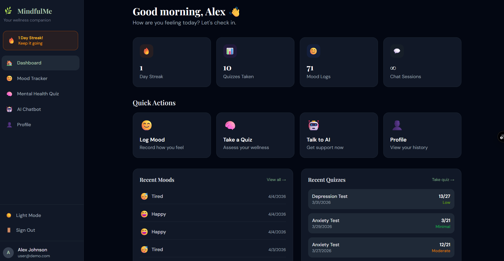
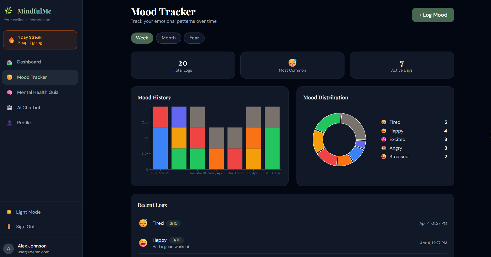
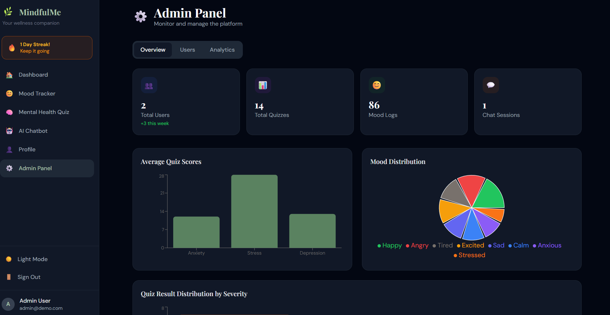

# 🌿 MindfulMe — Mental Health Support App


> 💡 A full-stack MERN application designed to improve mental wellness through mood tracking, AI-powered support, and psychological insights.

---

## 🌐 Live Demo

- 🚀 Frontend: https://mental-health-three-iota.vercel.app
- 🔗 Backend: https://mental-health-z4qe.vercel.app

---

## 📸 Screenshots

### 🏠 Dashboard


### 😊 Mood Tracker


### 🤖 Chatbot


## ⚙️ Admin Panel

  

---

## ✨ Features

### 🔐 Authentication & Authorization
- JWT-based authentication system
- Secure password hashing using bcrypt
- Role-based access control (User/Admin)
- Protected routes with session persistence

---

### 😊 Mood Tracker
- Track daily mood using emoji UI
- Intensity scale (1–10)
- Add notes for better tracking
- Weekly, monthly, yearly analytics
- Data visualization with charts

---

### 🧠 Mental Health Quizzes
- Anxiety (GAD-7)
- Depression (PHQ-9)
- Stress (PSS-10)
- Auto scoring and analysis
- Personalized feedback system
- History tracking

---

### 🤖 AI Chatbot
- Real-time chat interface
- Rule-based chatbot (works without API)
- Optional AI integration (OpenAI)
- Crisis detection alerts
- Chat history storage

---

### 👤 User Profile
- Edit profile details
- Change password securely
- Track activity stats
- Generate PDF reports

---

### ⚙️ Admin Dashboard
- User management system
- Platform analytics
- Mood distribution insights
- Quiz analytics and reports

---

### 🔥 Streak System
- Tracks daily login streak
- Encourages consistent usage
- Auto reset if missed

---

## 🏗️ Project Structure

mindful-app/
├── client/ # React + Vite frontend
│ ├── components/
│ ├── pages/
│ ├── redux/
│ └── services/
│
└── server/ # Node.js + Express backend
├── models/
├── controllers/
├── routes/
├── middleware/
└── index.js


---

## 🛠️ Tech Stack

| Category     | Technology |
|-------------|-----------|
| Frontend    | React, Vite, Tailwind CSS |
| Backend     | Node.js, Express.js |
| Database    | MongoDB, Mongoose |
| State Mgmt  | Redux Toolkit |
| Auth        | JWT, bcryptjs |
| Charts      | Recharts |
| Animation   | Framer Motion |
| PDF         | jsPDF |

---

## ⚙️ Installation & Setup


### 1️⃣ Clone Repository
```bash
git clone https://github.com/Sanjeev6235/mental_health.git
